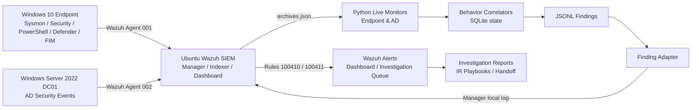
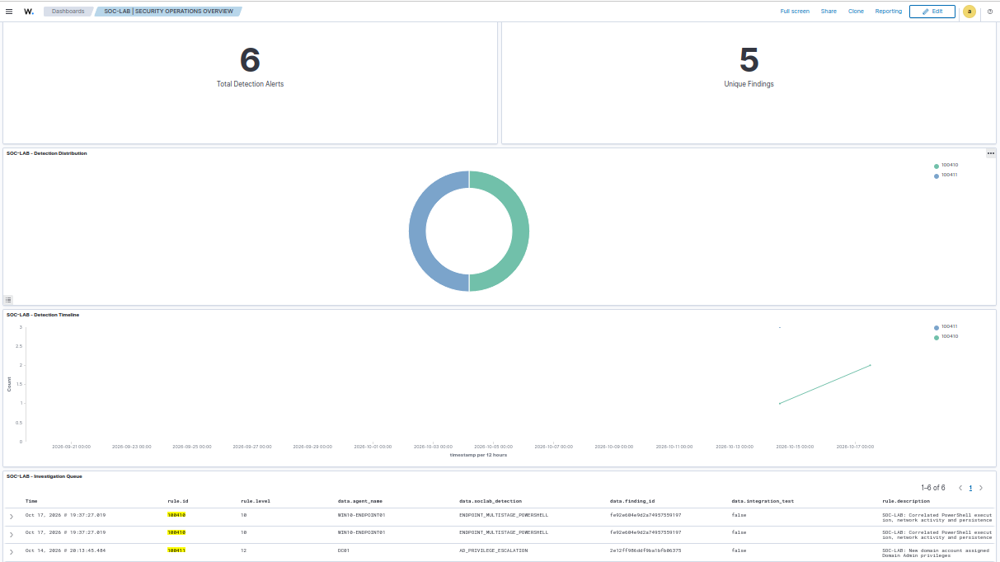
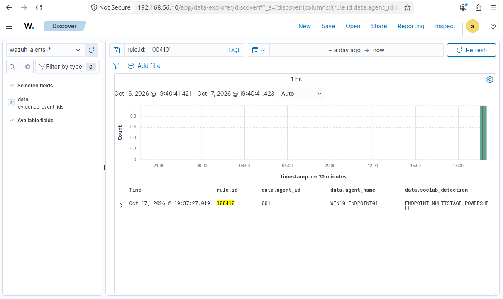
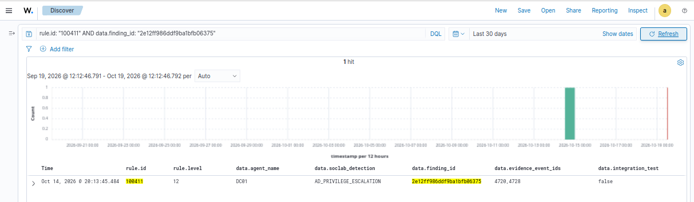
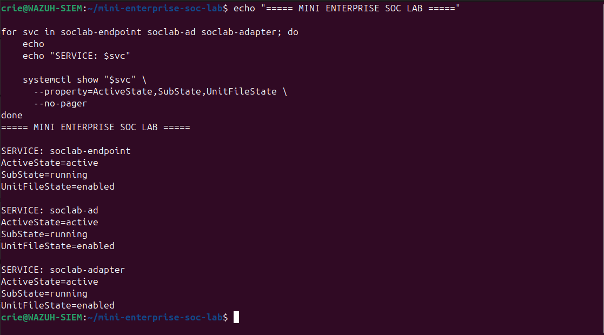
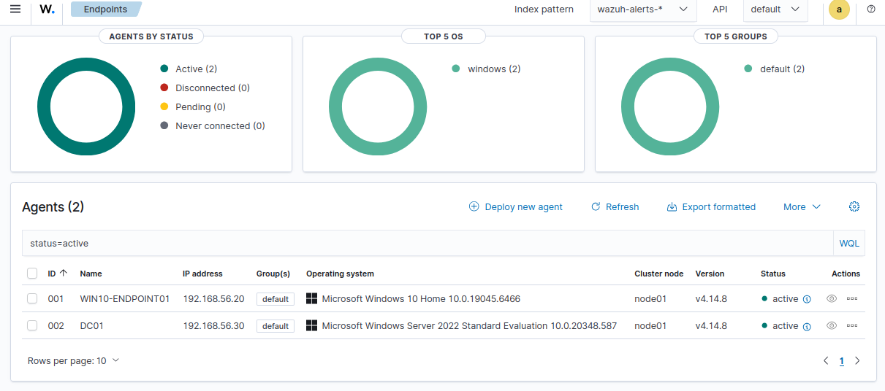

# Mini Enterprise SOC Lab — Endpoint & Active Directory Threat Detection

> **Status:** Portfolio lab with live detection pipelines validated on controlled security simulations; final documentation and public-safe evidence review in progress. **No real-world compromise is claimed.**

## Overview

I built a three-virtual-machine SOC environment to collect Windows endpoint and Active Directory security telemetry, create behavior-based findings with Python correlation engines, forward findings to Wazuh, and investigate the resulting alerts using documented SOC Tier 1 workflows.

**What makes this more than a SIEM installation:** Two custom stateful Python correlation engines, ongoing monitoring services, an alert adapter, raw-event investigations, security-hardening validation, a dashboard/investigation queue, and incident-response playbooks.

## Architecture



See [architecture/ARCHITECTURE.md](architecture/ARCHITECTURE.md).

## Lab systems

| System | Purpose | Scope |
|---|---|---|
| Ubuntu / `WAZUH-SIEM` | Wazuh Manager, Indexer/Dashboard, Python live monitoring and JSON finding adapter | Lab network `192.168.56.10` |
| Windows 10 Home / agent `WIN10-ENDPOINT01` | Endpoint telemetry / Sysmon / PowerShell / Defender / FIM | `192.168.56.20`, not domain-joined |
| Windows Server 2022 / agent `DC01` | Active Directory / domain-controller Security events | `192.168.56.30` |

> Hostnames/IP addresses describe an isolated demonstration lab, not a production network.

## Custom detections

| Detection | Wazuh rule | Source events | Correlation rule |
|---|---|---|---|
| `ENDPOINT_MULTISTAGE_POWERSHELL` | `100410` (level 10) | Sysmon 1, 3, 13 | Same source agent and ProcessGuid, within 120 seconds; encoded PowerShell + network + Run-key modification |
| `AD_PRIVILEGE_ESCALATION` | `100411` (level 12) | Security 4720, 4728 | New account SID matches added member SID, group RID 512 (Domain Admins), same source DC, within 300 seconds |

The AD investigator also reviewed **4729** (membership removed) as follow-up evidence; it is *not* a trigger for rule 100411.

## Validated investigation cases

**CASE-001 — Endpoint PowerShell:** Wazuh finding `fe92e604e9d2a74957559197`; Sysmon 1/13/3 sharing a ProcessGuid; controlled TCP connection to lab listener, temporary Run-key configuration, encoded PowerShell. Detection matched, *not* evidence of a genuine compromise. See [CASE-001 report](incident-reports/CASE-001/CASE-001-Endpoint-PowerShell-Investigation.md).

**CASE-002 — Domain Admins membership:** Finding `2e12ff986ddf9ba1bfb06375`; Security 4720 -> 4728 (8.582 sec), plus follow-up 4729 (~5.040 sec after addition). User SID and group SID were correlated; authorization and current state must be evaluated separately. See [CASE-002 report](incident-reports/CASE-002/CASE-002-AD-Privilege-Escalation-Investigation.md).

Both scenarios are **controlled lab exercises**. `integration_test=false` in an adapter alert means the adapter did not label the record as replay; it does **not** mean a real attacker was involved.

## Investigation workflow

```text
Windows event -> Wazuh agent -> archive -> live monitor
-> Python event correlation -> finding JSONL -> adapter
-> custom Wazuh rule -> dashboard investigation queue
-> analyst evidence review -> triage/report -> optional L1-to-L2 handoff
```

Explore [the response playbooks](incident-response/playbooks/README.md), [the handoff exercise](incident-response/tickets/CASE-001-SOC-L1-to-L2-Handoff.md), and [validation](validation/FINAL-ACCEPTANCE.md).

## Source code and reproducibility

- [Python engines](detection-engineering/src/) — **copy the exact reviewed deployed scripts from `/opt/soclab/` into this folder before publishing**. This template does not include source from the running VM.
- [Detection design](detection-engineering/README.md) and [scenarios](detection-scenarios/).
- [Deployment notes](deployment/README.md), sanitized Wazuh custom rules and service units where reviewed.
- Use isolated VMs and controlled exercises only; paths, versions and external dependencies must be confirmed against the live installation before claiming reproducibility.

## Evidence integrity and historical time limitations

Source Sysmon and AD Windows event JSONL files were collected and SHA-256 checked by the lab operator. **Raw event evidence is intentionally excluded from the public repository** because it can contain user SIDs, executable command lines, internal topology, and other sensitive details.

Historical cross-system timestamp differences were observed (~74 sec in CASE-001, ~12h53m in CASE-002). Later healthy NTP status does not retroactively repair old events. Reports preserve this limitation.

## Screenshots

Reviewed, sanitized dashboard, alert, investigation and service-status screenshots can be placed in [`screenshots/`](screenshots/README.md). Do not add unreviewed captures.

## Scope and limitations

- Personal isolated lab, not a production SOC or a live attacker investigation.
- Windows 10 Home is not AD domain joined; endpoint and DC telemetry are independent Wazuh agents.
- Rule matching demonstrates detection logic; it does not prove malware, data theft, or compromise.
- Detection uses selected Sysmon and Windows Security events; it is not comprehensive EDR/identity coverage.
- Linux service state and Wazuh integration were observed active; environment still requires final verification after any refactor.
- Any real containment requires relevant owner/L2/IR approval.

## Documentation and public safety

Start with [deployment](deployment/README.md), [validation](validation/FINAL-ACCEPTANCE.md) and [publication checklist](SECURITY-REVIEW.md). Raw logs, DBs, VM disks, credentials, secret keys, and full configs have not been intentionally published.

## SOC Dashboard

The SOC dashboard provides centralized visibility into
custom detection alerts, event correlation results,
and investigation activities.



## Endpoint Detection

The endpoint detection engine correlates suspicious
PowerShell execution, registry modifications, and
network connections using Sysmon telemetry.



## Active Directory Detection

The AD correlation engine identifies newly created
domain accounts that are subsequently added to the
Domain Admins group.



## Detection Services

The correlation engines and finding adapter are
managed using systemd services.



## Monitored Endpoints

The lab monitors a Windows 10 endpoint and a
Windows Server 2022 Domain Controller.



## SOC Investigation Queue

The Investigation Queue centralizes custom alerts
for SOC analyst triage and investigation.
